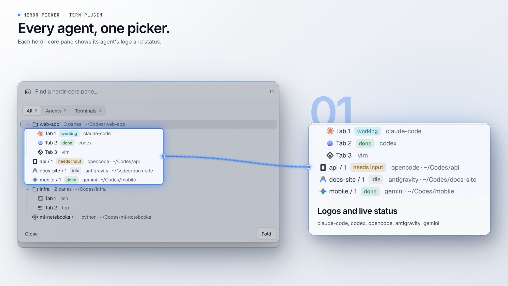
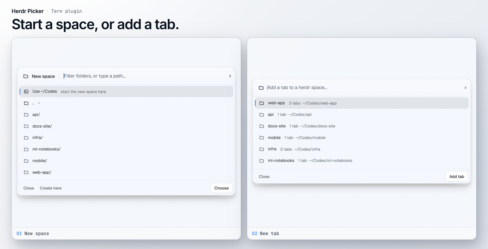

# Herdr Picker

English | [简体中文](README.zh-CN.md)

A Tern plugin for [herdr-core](https://herdr.dev) (`hc`): pick a running herdr-core pane, start a
new herdr space, or add a tab to one, and open it in a Tern block.





```sh
tern plugin install github.com/RookieZoe/tern-plugin-herdr-picker/plugin
```

For a window attached to a remote Tern host, install it on both machines:
[On a remote host](plugin/README.md#on-a-remote-host).

Usage, requirements and limitations: [plugin/README.md](plugin/README.md).

## Repository layout

- `plugin/`: the plugin package, the only folder Tern installs.
- `docs/`: Tern plugin API findings, research notes (`docs/research/`) and decision records.
- `GLOSSARY.md`: the terms used in code and docs.

## License

[MIT](LICENSE)
